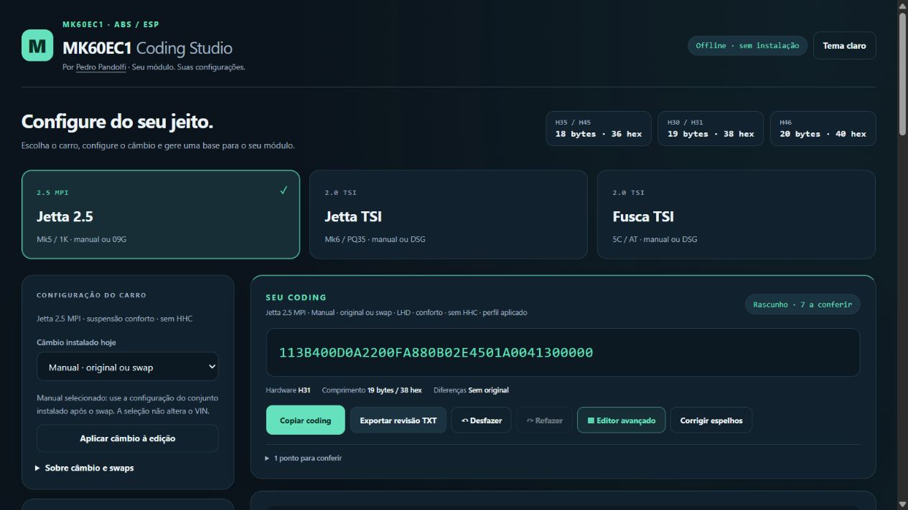

# MK60EC1 Coding Studio

**Criado e desenvolvido por [Pedro Pandolfi (@pandolfipedro)](https://github.com/pandolfipedro).**

Calculadora e editor offline de long coding ABS/ESP MK60EC1, em português, com presets para Jetta 2.5, Jetta TSI e Fusca TSI. Funciona em um único `index.html`, inclusive sem conexão.



## Presets

| Perfil | Escopo | Câmbio | Base inicial |
|---|---|---|---|
| Jetta 2.5 MPI | Mk5 / VIN plataforma 1K | Manual original/swap ou automático 09G | LHD, 288/253, conforto, sem HHC |
| Jetta 2.0 TSI | Mk6 / PQ35, VIN 16 ou AJ, MK60EC1 | Manual original/swap ou DSG | LHD, dianteiro 312, traseiro a disco, suspensão padrão/esportiva, sem HHC |
| Fusca 2.0 TSI | 5C/AT, VIN 16 ou AT, MK60EC1 | Manual original/swap ou DSG | LHD, dianteiro 312, traseiro a disco, suspensão padrão/esportiva, sem HHC |

Nos TSI, selecione **multilink ou eixo de torção** conforme o carro: a escolha altera plataforma/servo e seu espelho. Diâmetros traseiros, pinças, HBV, G85, sensores, câmbio e códigos PR precisam ser conferidos no conjunto instalado. Os presets não atendem gerações MQB nem módulos de outra família.

## Uso

1. Abra `index.html` no navegador.
2. Escolha o preset e o câmbio instalado hoje. Para swap, use **Manual · original ou swap**.
3. Selecione o módulo ABS identificado no Auto-Scan e informe o VIN.
4. Confira a prévia e clique **Aplicar esta base no editor**. Alterar um preset não sobrescreve a edição por conta própria.
5. Ajuste as funções. **Editor avançado** abre os bytes em um clique, pelo botão junto ao coding ou pelo atalho das funções.
6. Importe o original para comparar, salve a sessão JSON ou exporte a revisão TXT.

### Câmbio e swap manual

Os perfis 2.5 MPI e 2.0 TSI usam **EDS 2 tanto no manual quanto nos automáticos disponíveis**. Por isso, selecionar manual pode manter o mesmo hexadecimal ABS. O botão **Aplicar câmbio à edição** mantém os demais bits, configura somente o campo EDS conhecido e registra o conjunto na sessão/relatório.

O bit 7 do byte 16 **não é um bit universal de câmbio**: sua descrição varia entre 18, 19 e 20 bytes, chegando a NIRA/MCB. O aplicativo não o troca às cegas. A seleção não faz a codificação de ECU, TCU, Gateway ou adaptações exigidas pelo swap.

### Comprimento por hardware

| Hardware | Bytes | Dígitos hex |
|---|---:|---:|
| H35 / H45 | 18 | 36 |
| H30 / H31 | 19 | 38 |
| H46 | 20 | 40 |

A importação não completa, corta ou recalcula bytes silenciosamente. Espelhos são preservados ao importar; correções são explícitas. BH/BJ/BK/BL podem usar a opção de dois estágios no byte 6 conforme firmware; H46 usa o byte 19. XDS é revisável, não ativado indiscriminadamente.

## Executar e desenvolver

O arquivo pronto não precisa de instalação. Para editar as fontes e gerar o HTML, use Node.js 20 ou superior:

```sh
npm run build
npm test
npm run check
```

Não há dependências npm para instalar. Edite `src/core.js`, `src/ui.js` e `src/template.html`; `src/data/fields.json` contém as tabelas técnicas. O build gera o `index.html` da raiz e `dist/index.html`. O build via Node evita dependência de Python.

## Publicar no GitHub Pages

Este pacote está pronto para o repositório [pandolfipedro/mk60ec1-longcode](https://github.com/pandolfipedro/mk60ec1-longcode).

1. Copie **o conteúdo da pasta do pacote** para a raiz do repositório, incluindo `.github` e `src`. Não inclua arquivos pessoais de sessão ou Auto-Scans.
2. Envie as mudanças para a branch `main` pelo seu fluxo normal de Git.
3. Em **Settings → Pages → Build and deployment → Source**, selecione **GitHub Actions**.
4. Em **Actions**, acompanhe **Validar e publicar no GitHub Pages**. O workflow gera, testa e publica somente `dist`.
5. Confira o endereço retornado pelo job de publicação. Não há publicação confirmada apenas por copiar os arquivos.

Como alternativa sem build, publique o `index.html` já pronto por **Deploy from a branch**, apontando para `main` e `/ (root)`. Para esse modo, desabilite o workflow automático se não quiser que ele rode. Não misture edição manual do `index.html` com builds a partir de fontes desatualizadas.

O workflow inclui testes em pull requests e publica somente em push de `main` ou execução manual. Não contém tokens ou credenciais personalizados.

## Privacidade

O processamento é local: sem telemetria, API de consulta de VIN, login, CDN ou upload de Auto-Scan. Sessões e relatórios só saem do navegador por download explícito. Revise esses arquivos antes de compartilhá-los.

## Limites e referências

Os testes validam software e preservação dos bits. Não substituem validação física, documentação do módulo ou Basic Settings. Antes de gravar, preserve o Auto-Scan e o coding original e confirme hardware, software e equipamentos.

As referências técnicas estão em [NOTICE.md](NOTICE.md). Autoria e desenvolvimento do aplicativo: **Pedro Pandolfi**.

## Licença

Código e interface: [MIT](LICENSE), Copyright © 2026 Pedro Pandolfi. Referências técnicas de terceiros: [NOTICE.md](NOTICE.md).
